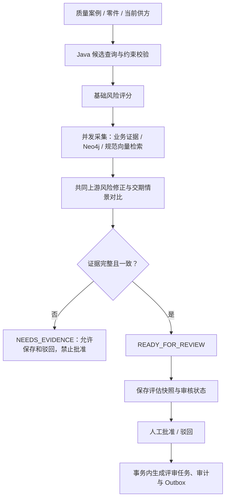

# 供应商风险分析与切换评审：升级版

## 原知识图谱没有删除

原 `GraphTools`、Neo4j 初始化、Qdrant/FastEmbed 文档检索、质量异常 LangGraph、Redis 检查点和原质量页面均保留。第一轮新增模块主要使用供方指标；本次把原图谱与规范检索接口接入风险分析，并新增独立的持久化审核闭环。

## 工作流与责任边界



- 基础评分仍为确定性规则：交付 50%、缺陷 PPM 30%、交期 20%。共同上游依赖增加 15 分，分数封顶 100。阈值和权重仅用于演示，不是训练后的预测模型。
- 使用 Neo4j 有界 `DEPENDS_ON*1..3` 查询识别当前供方与候选供方的共同上游；同时读取零件影响车型。图谱和 BOM 车型集合不一致或案例未关联当前供方时，禁止进入可批准状态。
- 规范检索复用原 Qdrant / FastEmbed 工具，保留文档编号、文本、相似度；相似度不足 0.55 的结果不计为有效证据。门槛未进行业务校准。
- 原生向量检索在子进程中执行，25 秒超时；原生库失败不会直接使风险 API 进程崩溃，而会产生 UNAVAILABLE 证据。
- 放宽 14 天交期的情景结果单独展示，不会改变正式推荐约束。
- 指标缺失、30 天以上旧指标、未来异常时间、资格不足、产能不足、交期超限均处理为不可用或排除。
- 评审快照与决策存储于 Java 业务数据库，不依赖 Python 进程内内存。新审核流程使用数据库状态机，**没有冒称新增 LangGraph Redis 中断恢复**；原质量流程的 Redis 机制保留。
- 相同幂等键和输入返回原快照；重复批准返回同一任务。数据库行锁、版本检查和事务保证并发批准只创建一次任务。批准前重新检查当前资格、产能、交期、指标变化、24 小时快照有效期和案例状态。
- 批准复用原 `FactoryOpsService.createAction`，在同一事务内创建 `SUPPLIER_SWITCH_REVIEW` 任务、原审计和 Outbox，再记录风险审核状态与审计。驳回不创建任务或事件。**不会直接切换供货关系或发布采购订单。**

## 运行模式

`FACTORYOPS_RISK_EVIDENCE_MODE`：

| 值 | 行为 |
|---|---|
| structured（独立服务默认） | 实查 Java 业务数据；图谱和规范显示 NOT_CONFIGURED；可评估、保存、驳回，禁止批准 |
| demo | 实查业务数据，展示明确标注 DEMO 的图谱与规范资料；禁止批准 |
| live | 调用实际 Neo4j 和规范检索适配器；只有三源证据 AVAILABLE、一致且存在备选时才允许进入待审核状态 |

完整 Compose 已配置 live。它仍需要原 Neo4j/Qdrant 数据初始化与所有基础设施。本次未启动这些外部服务，不能声称已完成真实图谱/向量端到端联调。

## Windows 启动（无 Docker 的演示方式）

从项目根目录安装独立风险依赖：

```powershell
python -m venv .venv-risk
.\.venv-risk\Scripts\python.exe -m pip install -r services/agent-service/requirements-risk.txt
```

第一终端，项目根目录：

```powershell
cd services/business-service
mvn "-Dmaven.repo.local=../../.tools/m2" -Prisk-demo package -DskipTests
java -jar target/business-service-0.1.0.jar --spring.profiles.active=risk-demo --server.address=127.0.0.1
```

默认 H2 内存演示数据随 Java 退出消失。若需跨重启保留评审，可在启动 Java 的同一终端先设置独立文件库路径，例如在 `services/business-service` 目录中：

```powershell
$env:FACTORYOPS_RISK_DEMO_DB='jdbc:h2:file:./target/risk-demo-db;MODE=MySQL;DATABASE_TO_LOWER=TRUE'
```

然后运行上述 Java 启动命令。该文件库仍为本地演示库，Outbox 发布关闭。

第二终端，项目根目录：

```powershell
$env:FACTORYOPS_RISK_EVIDENCE_MODE='demo'
cd services/agent-service
..\..\.venv-risk\Scripts\python.exe -m uvicorn factoryops_agent.supplier_risk:app --host 127.0.0.1 --port 8082
```

第三终端，项目根目录：

```powershell
cd frontend
npm.cmd ci --ignore-scripts --cache ../.tools/npm
npm.cmd run dev -- --host 127.0.0.1
```

打开 `http://localhost:5173/supplier-risk`，默认 CASE-001 / PART-001 / SUP-001。页面展示风险拆分、证据来源、图谱影响、交期情景、保存及恢复评审、审核意见和审计记录。demo 模式的批准按钮不可用是预期行为。原 `/quality` 页面保留；独立风险服务没有完整质量 API，要使用原质量闭环仍需原完整服务栈。

实际图谱/向量模式应使用完整 Agent 依赖 `services/agent-service/pyproject.toml`。配置 `FACTORYOPS_BUSINESS_URL`（包含 `/api/v1`）、`FACTORYOPS_NEO4J_URI`、Neo4j 用户/密码、`FACTORYOPS_QDRANT_URL` 和 `FACTORYOPS_RISK_EVIDENCE_MODE=live`。项目原索引初始化脚本会重建文档集合，仅应对新建的演示资料库执行；本次未执行该操作。新增图谱种子含 SUP-002/003/004 和共同上游 UP-DEMO-001，规范资料增加 DOC-SOURCING-001。

## API

Java 前缀 `/api/v1/supplier-risk`：

- GET `/candidates?partNumber=PART-001`
- GET `/context?partNumber=PART-001&caseNumber=CASE-001`
- POST `/reviews`：内部可信 Agent 提交快照，参数 `request_key`、`case_number`、`snapshot`
- GET `/reviews/{id}`、GET `/reviews/{id}/audit`
- POST `/reviews/{id}/decision`：`version`、`approved`、`supplier_code`、`actor`、`reason`

Python 使用同一前缀：

- POST `/assess`：`part_number`、`current_supplier`、`case_number`（默认 CASE-001）、`required_units`、`max_lead_days`
- POST `/reviews`：`request_key`、`request`（上述评估输入）；由服务端重新评估后保存，不接收客户端任意快照
- GET `/reviews/{id}`、GET `/reviews/{id}/audit`、POST `/reviews/{id}/decision`

未知对象返回 404、无效输入返回 400/422、重复冲突/不可批准/过期返回 409、业务服务不可用返回 503。图谱和规范失败体现在证据状态及审核阻断中，不伪造成功。

## 已执行验证（2026-10-21）

| 验证 | 真实结果 |
|---|---|
| Java / H2 MySQL 模式集成测试 | 11 项通过：原质量业务 1、候选查询 2、审核事务/幂等/并发/失效约束 8 |
| Python 新模块与原质量图测试 | 31 项通过，含证据缺失、冲突、共同上游、时间有效性、情景约束、检索低相关、原生进程失败、并发创建键恢复及原质量批准/驳回 |
| Flyway | V1–V4 迁移成功；未改写已存在的 V1–V3 迁移 |
| 风险看板严格类型检查 | `npm run check:risk` 通过 |
| Vite 打包 | 通过，保留原大型包警告 |
| 真实 Java/Python HTTP 联通 | 候选及结构化证据读取、缺失真实证据时 409、评审重试、驳回与审计通过 |
| 跨进程重启恢复 | 文件 H2 下停止并重启 Java/Python 后恢复同一快照及 REJECTED 状态，通过 |
| 演示模式 | 明确标记 DEMO，共同上游加分 15，批准仍被阻止，通过 |

复现命令：

```powershell
# services/business-service 目录
mvn "-Dmaven.repo.local=../../.tools/m2" test
# services/agent-service 目录；含原质量图测试需补齐完整模块的导入依赖
..\..\.venv-risk\Scripts\python.exe -m pytest tests/test_supplier_risk.py tests/test_risk_upgrade.py tests/test_graph.py -q
# frontend 目录
npm.cmd run check:risk
.\node_modules\.bin\vite.cmd build
# 项目根目录（先构建 risk-demo jar）
.\.venv-risk\Scripts\python.exe scripts/smoke-supplier-risk.py
```

## 未验证与使用限制

- Neo4j/Qdrant 实际服务、真实向量模型、本机 ONNX 兼容性及图谱初始化尚未联调。多源成功分支使用注入测试数据验证；不能把这些测试说成外部系统已跑通。
- 完整 MySQL/Redis/Neo4j/Qdrant/RabbitMQ 栈与全仓历史测试未跑，浏览器视觉/交互自动化未做。原质量流程仅相关回归通过。
- 完整前端 `npm run build` 的历史类型错误仍存在于未修改的 Console/Replay/IndustryGraph 等页面；不能把 Vite 打包通过等同于全仓类型检查通过。
- 既有前端依赖审计报告 53 项告警，未进行破坏性自动升级。
- 当前审核人字段为本地演示记录，没有身份认证或角色授权；Java 快照接口按内部 Agent 信任边界设计，不能直接当成面向公网的生产审批系统。
- 数据均为虚构；指标权重、共同上游惩罚及相似度阈值没有业务校准。无真实 PPAP/IATF 验证、采购自动执行、训练预测模型、生产准确率或降本数据。
- 评分、排除、排序和能否进入审核均由固定规则决定，没有把规则包装为 LLM 自主推理。新模块使用 LangGraph 条件分支，跨重启审核恢复由数据库快照负责。
- 工作流最后的 `explain` 节点可选调用 OpenAI 兼容大模型，把评分结果和证据写成风险说明（`narrative` 字段）。该节点在规则结果确定后运行，只能写入说明，不能改变推荐；未配置模型或输出校验失败时使用规则说明。本地独立服务不需要 LLM API。

## 简历归属

这是在既有开源平台上进行的 AI 辅助二次开发。项目描述可说明已经实现的系统能力；个人职责仅保留朋友实际参与、复现、修改并能解释的部分，不应声称独立原创整个平台，也不应认领原平台已有知识图谱/向量检索引擎的原创实现。
