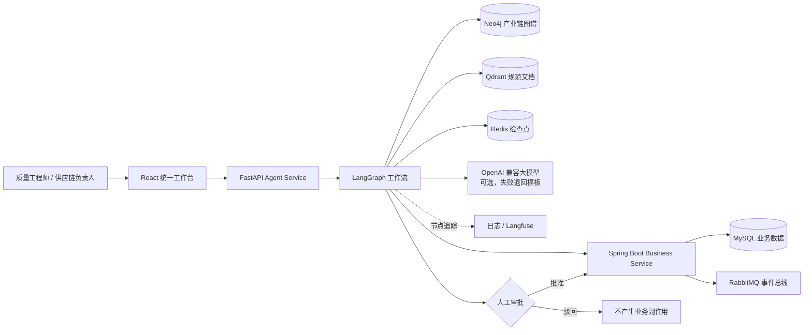

# SupplyGuard AI

> 面向制造质量与供应链运营的证据驱动智能体平台

[](https://github.com/lijy-forge/SupplyGuard-Ai/actions/workflows/factoryops-full.yml)
[](https://github.com/lijy-forge/SupplyGuard-Ai/actions/workflows/factoryops-integration.yml)

SupplyGuard AI 帮助质量工程师、供应链负责人和质量主管处理制造质量异常。系统从业务数据、产业链图谱和质量规范中检索证据，由大模型基于证据生成处置建议和风险说明，并在执行任何正式业务写入前强制进行人工审批。

本项目基于开源项目 [HIT-ICES/SupplyChainAgent](https://github.com/HIT-ICES/SupplyChainAgent)（Apache License 2.0）二次开发，详见文末[开源来源与归属](#开源来源与归属)。

## 核心能力

- **质量异常处置**：LangGraph 工作流汇总 MySQL 业务数据、Neo4j 产业链图谱和 Qdrant 规范文档三类证据，由大模型生成结构化处置建议，人工审批后才创建整改措施。
- **供应商风险评估与切换评审**：规则评分 + 硬约束筛选候选供方，Neo4j 识别共同上游依赖；大模型只负责把评分结果写成可读的风险说明。
- **人工审批闭环**：LangGraph `interrupt/resume` + Redis 检查点，审批可跨服务重启恢复；风险评审使用数据库状态机、幂等键、行锁与版本校验。
- **审计与事件交付**：Spring Boot 负责业务规则、审计记录、Transactional Outbox 和 RabbitMQ 事件发布，消费端用 Redis 幂等去重。
- **可观测性**：每个工作流节点记录输入、输出、状态和耗时，结构化日志始终输出，配置 Langfuse 后同步上报。
- **真实/离线模式分离**：服务不可用时不会伪造成功；离线体验数据会被清楚标记，并且不会写入业务系统。

## AI 与规则的边界

大模型只负责“把证据组织成可读的建议”，任何会影响业务结果的判断都由规则和人工完成。

| 环节 | 由谁决定 | 实现 |
|---|---|---|
| 质量处置建议的结论、措施文字、引用证据、置信度 | **大模型** | `services/agent-service/factoryops_agent/graph.py` `answer` 节点 → `llm.py` `ContainmentRecommendation` |
| 供应商风险说明（摘要、关键风险） | **大模型** | `supplier_risk.py` `explain` 节点 → `llm.py` `RiskNarrative` |
| 证据检索与证据状态（AVAILABLE / EMPTY / UNAVAILABLE / CONFLICT） | 规则 | `graph.py`、`risk_evidence.py`、`supplier_risk.py` `enrich` |
| 风险评分（交付 50%、缺陷 PPM 30%、交期 20%，共同上游 +15） | 规则 | `supplier_risk.py` `assess` / `enrich` |
| 候选排除（资格、产能、交期、指标 30 天时效）与推荐排序 | 规则 | `supplier_risk.py` `assess` / `recommend` |
| 能否进入待审核（三类证据完整且有候选） | 规则 | `supplier_risk.py` `route` + Java `SupplierRiskReviewService.complete()` |
| 是否执行整改或切换评审任务 | **人工审批** | LangGraph `interrupt` / Java `decide()` |
| 整改措施类型 | 规则（固定为 `SUPPLIER_CONTAINMENT`） | `graph.py` |

大模型输出的保护措施：

- 输出必须通过 Pydantic 模式校验（字段、类型、置信度 0–1）。
- 引用的证据编号必须是本次真实检索到的证据；处置建议只能引用状态为 `AVAILABLE` 的证据，否则视为编造并拒绝。
- 调用失败、超时、非 JSON、校验不通过或引用未知证据时，退回确定性模板，并在结果中记录 `answer_source` 和 `llm_fallback_reason`。
- 风险说明节点在规则结果确定之后运行，只写入 `narrative` 字段，结构上无法修改评分和推荐。
- 前端分别标注“大模型生成”或“规则模板”。

未配置大模型时，两条工作流完全使用模板，功能不受影响。

### 配置大模型

支持任何 OpenAI 兼容的 `/chat/completions` 接口（如 OpenAI、DeepSeek、通义千问兼容模式、本地 vLLM）：

可以复制 `services/agent-service/.env.example` 为 `.env`（已被 git 忽略）后填写，或直接设置环境变量：

```bash
export FACTORYOPS_LLM_PROVIDER=openai-compatible
export FACTORYOPS_OPENAI_BASE_URL=https://api.deepseek.com      # 已验证
export FACTORYOPS_OPENAI_API_KEY=<你的密钥>
export FACTORYOPS_OPENAI_MODEL=deepseek-chat                    # 默认 gpt-4.1-mini
export FACTORYOPS_LLM_TIMEOUT_SECONDS=30
export FACTORYOPS_LLM_JSON_MODE=true      # OpenAI / DeepSeek 支持 response_format=json_object
```

### 配置可观测性

节点追踪默认输出到日志 `supplyguard.trace`（每个节点一行 JSON：`span`、`thread_id`、`status`、`duration_ms`、截断后的 `input`/`output`）。设置以下变量后同时上报 Langfuse：

```bash
export LANGFUSE_PUBLIC_KEY=pk-lf-...
export LANGFUSE_SECRET_KEY=sk-lf-...
export LANGFUSE_HOST=https://cloud.langfuse.com
```

## 黄金路径

```text
发现质量异常
    ↓
提交批次影响调查
    ↓
查询业务数据（批次、检验、质量案例，并解析批次供应商）
    ↓
检索产业链图谱（零件、车型、供应商依赖）
    ↓
检索质量规范（SOP、8D、FMEA），每篇命中文档作为一条可引用证据
    ↓
大模型基于证据生成结构化处置建议（失败时退回模板）
    ↓
质量负责人批准或驳回
    ↓
批准后创建纠正措施并记录审计事件
```

推荐演示案例为 `CASE-001`：`BATCH-001` 中的 `PART-001` 检验不合格，该零件同时影响 `VM-A` 和 `VM-B` 两个虚构车型平台。

## 统一前端

访问地址：<http://localhost:5173>

| 页面 | 用途 |
|---|---|
| 工作台 | 查看系统定位、模块入口和推荐使用顺序 |
| 质量异常处置 | 运行智能体调查，查看证据、建议（标注来源与置信度）并完成人工审批 |
| 供应商风险 | 风险评分看板、证据追溯、情景对比、风险说明、评审快照与审核 |
| 产业链图谱 | 查看企业、零件、交易、通信和上下游影响关系（来自上游项目） |
| 仿真与配置 | 管理大模型、智能体、工作流与仿真实验（来自上游项目） |
| 调研问卷 | 管理实验及调查过程中使用的问卷（来自上游项目） |

质量异常处置页会主动检查 Agent Service：

- **实时结果**：证据与建议来自实际 Agent API；审批会恢复 LangGraph 工作流，并可能产生正式业务写入。
- **离线体验**：仅在用户主动选择后加载；页面会显示“离线体验数据”，审批不会调用后端，也不会创建纠正措施。

## 快速开始

### 方式一：只体验统一前端

适合先了解页面和业务流程，不需要 Docker。

Windows 可直接双击：

```text
scripts\run-factoryops-demo.cmd
```

或在 PowerShell 中运行：

```powershell
& '.\scripts\run-factoryops-demo.ps1'
```

脚本会安装缺失的前端依赖、启动开发服务器并打开 <http://localhost:5173>。由于完整后端没有启动，“质量异常处置”会明确显示服务未连接；此时可主动加载离线体验数据。

### 方式二：运行完整 SupplyGuard 架构

要求：

- Docker Desktop 与可用的 Docker Engine
- Node.js 与 npm
- 建议至少预留 8 GB 内存

先启动完整服务栈：

```powershell
& '.\scripts\run-factoryops.ps1' -NoBrowser
```

再启动统一前端：

```powershell
& '.\scripts\run-factoryops-demo.ps1'
```

也可以直接使用 Compose：

```bash
docker compose -f docker/docker-compose.factoryops.yml up --build --detach
```

完整模式下，统一前端通过本地代理访问 Agent Service。进入“质量异常处置”，点击“运行真实调查”，即可执行 SQL、图谱、文档检索与人工审批工作流。如需大模型生成建议，在 `agent-service` 容器中设置上文的 `FACTORYOPS_LLM_*` 变量。

停止服务：

```bash
docker compose -f docker/docker-compose.factoryops.yml down
```

如需同时删除本地容器数据卷，请在确认不再需要数据后执行：

```bash
docker compose -f docker/docker-compose.factoryops.yml down -v
```

供应商风险模块也可以不使用 Docker 单独启动，见 [模块说明](docs/supplier-risk.md)。

## 服务地址

| 服务 | 地址 | 说明 |
|---|---|---|
| 统一前端 | <http://localhost:5173> | 推荐使用的 SupplyGuard 操作界面 |
| Business Service | <http://localhost:8081/api/v1> | Spring Boot 业务 API |
| Business Health | <http://localhost:8081/actuator/health> | 业务服务健康检查 |
| Agent Service | <http://localhost:8082> | FastAPI + LangGraph 智能体服务 |
| Agent Health | <http://localhost:8082/health> | 智能体服务健康检查 |
| RabbitMQ | <http://localhost:15672> | 消息队列管理界面 |
| Neo4j Browser | <http://localhost:7474> | 产业链图数据库界面 |
| Qdrant | <http://localhost:6333> | 向量数据库 API |

## 系统架构



架构原则是将确定性的业务写入与概率性的智能体推理分离：

- Spring Boot 是业务记录与规则的唯一权威来源。
- Agent Service 负责只读检索、证据汇总和建议生成；大模型输出必须引用真实证据编号。
- 所有事实结论都引用 `STRUCTURED`、`GRAPH` 或 `DOCUMENT` 证据，并标注证据状态。
- 任何纠正措施或切换评审任务写入都必须经过人工审批。

## 技术栈

| 层级 | 技术 |
|---|---|
| 前端 | React 18、TypeScript、Vite、Ant Design、AntV G6、Deck.gl |
| 智能体 | Python 3.12、FastAPI、LangGraph、Pydantic、OpenAI 兼容接口 |
| 业务服务 | Java 21、Spring Boot 3.5、Flyway、Maven |
| 业务数据库 | MySQL 8.4（测试与独立演示使用 H2 MySQL 模式） |
| 工作流状态 | Redis Stack |
| 产业链图谱 | Neo4j 5 |
| 文档检索 | Qdrant、FastEmbed（`BAAI/bge-small-en-v1.5`） |
| 事件系统 | RabbitMQ 4 |
| 可观测性 | 结构化日志、Langfuse（可选） |
| 交付与验证 | Docker Compose、GitHub Actions、Pytest、JUnit |

## 项目目录

```text
SupplyGuard-Ai/
├─ frontend/                    # 当前统一 React 工作台
├─ services/
│  ├─ business-service/        # Spring Boot 业务核心、评审状态机、审计与事件
│  └─ agent-service/           # FastAPI + LangGraph 智能体工作流、LLM 接入、节点追踪
├─ evals/                      # 18 个离线评测场景与运行器
├─ factoryops/                 # Phase 1 Python 领域模型与 API 基础
├─ docker/                     # SupplyGuard Compose 编排
├─ scripts/                    # Windows 一键启动与黄金路径脚本
├─ tests/                      # Phase 1 领域、应用、仓储与 API 测试
├─ docs/                       # 架构、数据、API、运维与验收文档
├─ agentsociety/               # 保留的上游仿真兼容代码
└─ SupplyChainAgent/            # 保留的上游旧版实验运行路径
```

## 验证与评测

智能体测试（含 LLM 接入、证据、可观测性与评测场景）：

```bash
cd services/agent-service
pip install -e ".[test]"
pytest -q
```

离线评测：

```bash
python evals/run_eval.py              # 18 个场景，使用脚本化的模型替身
python evals/run_eval.py --live-llm   # 使用已配置的真实模型，报告输出通过校验的比例与退回原因
```

评测场景覆盖：三源证据完整、模型输出有效、模型引用不存在的证据、模型输出非 JSON、文档库不可用、图谱不可用、文档无命中、显式指定供应商；风险流程的多候选排除、文档证据缺失、图谱与 BOM 冲突、案例未关联当前供方、无可用候选、共同上游改变排序、交期放宽情景、指标过期、模型试图推翻推荐、演示数据。详见 [评估体系](docs/19_evaluation.md)。

业务服务测试：

```bash
cd services/business-service
mvn --batch-mode verify
```

前端打包：

```bash
cd frontend
npm ci
npm exec vite -- build
```

Compose 配置检查：

```bash
docker compose -f docker/docker-compose.factoryops.yml config
```

CI 分为代码级验证和真实基础设施集成验证。完整集成流程会启动 MySQL、Redis、RabbitMQ、Neo4j、Qdrant、Business Service 与 Agent Service，并验证 SQL + 图谱 + 文档证据、人工审批跨重启恢复、业务写入和事件幂等性。

## 演示数据说明

仓库内置数据全部为确定性、虚构的制造质量数据，不代表任何真实企业、供应商、车型、零件、批次或质量事故。

- **服务架构（`services/`）使用的 Flyway 种子数据**：4 个供应商、1 个零件、2 个车型、1 个批次、1 条检验记录、1 个质量案例，以及 4 个供应商的风险指标；Qdrant 索引 13 篇文档（多数为合成文本）。
- **Phase 1 Python 模块（`factoryops/`）的数据集**：10 个供应商、30 个零件、4 个车型、36 个批次等，详见 [演示数据文档](docs/09_seed_dataset.md)。

## 进一步阅读

- [完整架构](docs/15_full_architecture.md)
- [智能体工作流](docs/16_agent_workflow.md)
- [数据与事件](docs/17_data_and_events.md)
- [黄金路径演示](docs/18_golden_path_demo.md)
- [评估体系](docs/19_evaluation.md)
- [运维说明](docs/20_operations.md)
- [供应商风险模块](docs/supplier-risk.md)
- [API 契约](docs/08_api_contract.md)

## 当前边界

- 大模型接入已用 DeepSeek `deepseek-chat` 跑过一次真实评测（2026-10-25）：18 个场景全部通过，18 次模型输出全部通过模式与证据编号校验，详见 [评估体系](docs/19_evaluation.md)。这是虚构数据上的单次运行，用于证明防护机制在真实模型下有效，不代表统计意义上的回答质量。
- Langfuse 上报已对照官方 SDK 接口实现，并验证上报失败不影响工作流；**尚未连接真实 Langfuse 项目验证**。
- 风险评分权重、0.55 的文档相似度阈值和 +15 的共同上游附加分是演示规则，未经历史数据校准。
- 供应商风险模块在真实 Neo4j / Qdrant 上的端到端运行尚未验证，CI 集成测试只覆盖质量处置流程。
- 实时智能体调查依赖完整基础设施；仅启动前端时只能使用明确标记的离线体验数据。
- 正式生产部署仍需补充身份认证、权限模型、企业数据连接器、密钥管理和安全审计策略；目前审核人为自由文本。

## 开源来源与归属

本项目基于 [HIT-ICES/SupplyChainAgent](https://github.com/HIT-ICES/SupplyChainAgent) 的开源代码二次开发（Apache License 2.0），保留了上游仿真兼容代码（`agentsociety/`、`SupplyChainAgent/`）、产业链图谱与仿真配置等前端页面以及原许可证。

SupplyGuard 新增的部分：`services/` 下的 Spring Boot 业务服务与 FastAPI/LangGraph 智能体服务（质量处置工作流、供应商风险评估与评审、LLM 接入、节点追踪）、`frontend/` 中的质量异常处置与供应商风险页面、`evals/` 评测场景、`docker/` 编排与 CI 工作流，以及 `factoryops/` Phase 1 模块。

详细复用范围与归属说明见 [开源归属文档](docs/06_open_source_attribution.md)。
